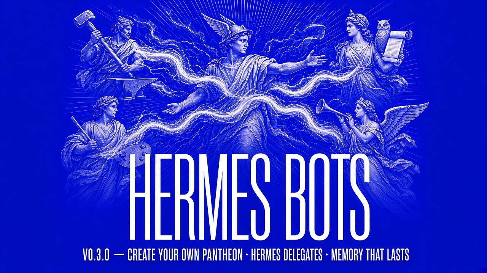
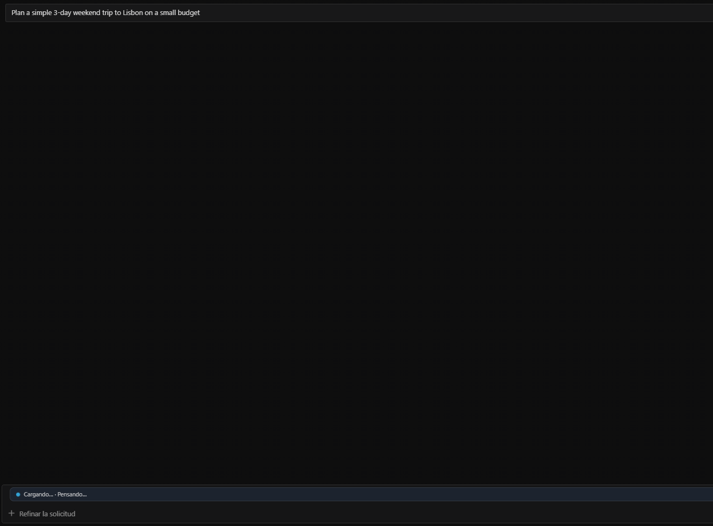
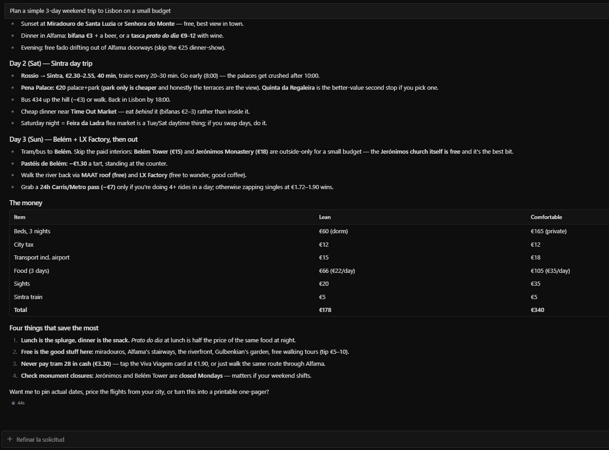
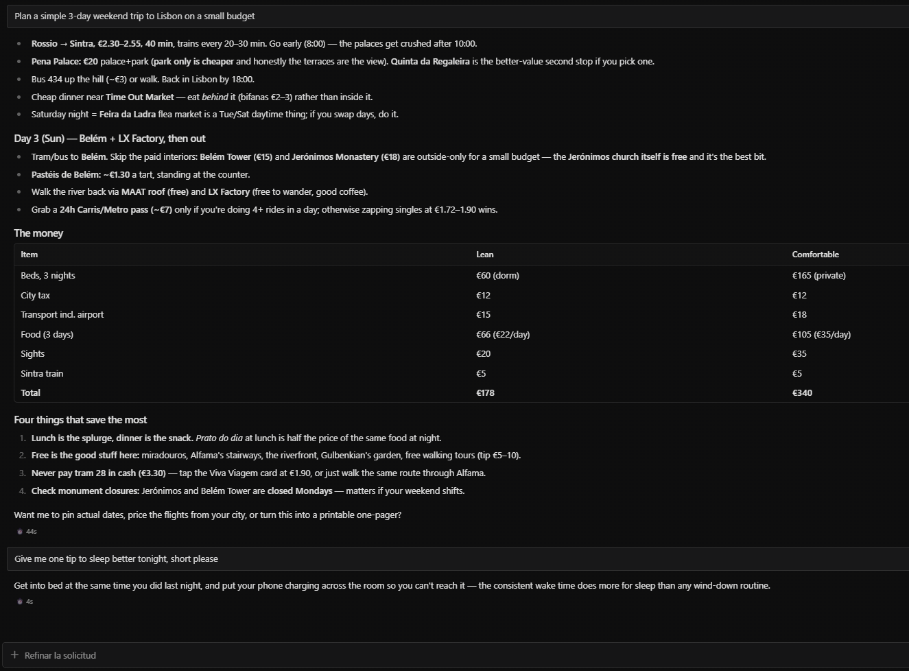

# Hermes Bots para Hermes




> Nombre visible **Hermes Bots** · el id y la carpeta del plugin siguen siendo `bot-chat-agent` (para que instalar y actualizar no se rompa).

[English](README.md)

> Un Bot Chat de Hermes más tranquilo y simple, para quien solo quiere respuestas, con memoria, una tarjeta de estado y un equipo de especialistas que solo aparecen si tú dices que sí.

**0.3.0** suma, sobre la 0.2.0 (estilo, guardia, barra de estado): guardia reforzada, recordatorio de pedidos pendientes, memoria local corta y larga (`/memoria`), entrega durable en segundo plano, tarjeta de estado con delegaciones entre bots, un **panteón casi automático pero opcional** de bots especialistas dentro del panel **Bots** de siempre, un puente a cron y un motor de contexto opcional (apagado por defecto).

**Dos mitades, un paquete.** La mitad Python funciona al activar el plugin. La mitad **Desktop** (tarjeta de estado, ofertas del panteón y creación de perfiles) es **opcional dentro de la app**: abre **Capacidades → Plugins → Hermes Bots** y ponla en **On**. Sin eso sigues teniendo estilo, guardia y memoria, pero no la tarjeta ni las ofertas, y `/pantheon create` solo te imprime los comandos de terminal.

## Por qué existe

Hermes es muy potente, y esa potencia se ve en pantalla: bloques de razonamiento, tarjetas de herramientas,
diffs, logs, preguntas de seguimiento. Para un desarrollador eso está genial. Para mucha gente (estudiantes,
emprendedores, familia, cualquiera que no sea técnico) puede ser abrumador.

**Hermes Bots** les da un Bot Chat de Hermes más amable: preguntas, ves una barra discreta de
*"Cargando…"* y recibes una respuesta corta y directa. Menos cosas en pantalla, menos preguntas, el mismo
Hermes por debajo. Si quieres ver todo el detalle, abre una sesión normal: queda exactamente igual.

## Capturas

| Cargando | Respuesta | Corto y directo |
|---|---|---|
|  |  |  |

## Qué hace

| Capa | Qué cambia |
|---|---|
| Estilo (`pre_llm_call`) | Un contrato corto de "actúa, no narres": un acuse (`Voy a…`), hace el trabajo, resultado corto. Máximo una pregunta por turno. |
| Guardia de seguridad (`pre_tool_call`) | **Bloquea** acciones riesgosas (secretos, borrados, git destructivo, push a ramas protegidas, mensajes salientes, modelos caros, saltarse el candado del kanban) y te pregunta primero. Cubre tanto el Bot Chat como sus subagentes hijos (`delegate_task`). Nunca aprueba nada por ti. |
| Equipo | Sin `team.assignees`, el bot trabaja solo. Con nombres de perfiles reales, crea subtareas y no las cierra hasta que el tablero las muestra hechas. |
| Desktop | Una barra de estado discreta (`Cargando… · <paso>`, `Esperando tu OK`, `Esperando a <perfil>`, `Listo · <resumen>`, `Error: <resumen corto>`) y el razonamiento colapsado por defecto mientras estás en un Bot Chat. |
| `/memoria` (alias `/botmemory`) | Lista lo que el plugin recuerda, olvida o edita una entrada por id, y borra todo con confirmación. `/memoria` responde en español. |
| Panteón (automático, opcional) | Si un pedido encaja claramente con una especialidad que no tienes, Hermes añade UNA línea («Puedo crear a Daedalus (código) para esto, ¿lo creo?»). Con un sí simple crea el perfil, lo añade a `team.assignees` y le pasa el pedido con `message_agent`. Sin ese sí no se crea nada. Aparece como una fila más del panel **Bots**; no hay panel aparte. |
| Panel de estado | Una tarjeta expandable encima del compositor: bot activo y los demás, delegaciones en vivo (`Hermes → Daedalus: esperando respuesta` → `listo`, solo cuando llega el aviso real de que terminó), tiempo transcurrido, aviso de *sin avance*, pendientes, memorias recordadas, tokens y una pista de `/memoria`. Se apaga con `status_panel.enabled: false`. |

Solo las sesiones llamadas **"Bot Chat"** (el título que usa el Modo Bot de Hermes) y sus hijas de compactación reciben el estilo de respuesta.
La guardia de seguridad también protege las sesiones hijas `delegate_task` / subagentes lanzadas desde un Bot Chat (heredan la protección del Bot Chat padre). Las sesiones normales y sus subagentes siguen igual. El trabajador kanban del perfil asignado queda fuera de esa guardia, así que puede entregar su tarjeta.
Sin `team.assignees` el bot trabaja solo. Con nombres de perfiles, espera a que el tablero marque la tarjeta como hecha. `relaxed` mantiene el candado del kanban y apaga esa espera. La guía completa está en [README.md](README.md).

**Fase 4 — una versión, dos modos.** Una instalación nueva es individual por defecto; un equipo existente que ya lista compañeros (en `team.assignees` o en la clave antigua `team.gods`, que sigue funcionando) no se desactiva con el nuevo default. Si las dos claves existen y difieren, el plugin bloquea con una explicación en vez de adivinar. En modo individual, crear una tarjeta para un perfil no configurado se bloquea (no se inventan compañeros).

## Instalar

Requiere Hermes `>= 0.22.5` (verificado: esa versión ya tiene los hooks que usa el plugin — `post_llm_call`, `agent_loop_stopped`, `kanban_task_blocked`).

```bash
hermes plugins install Tormen28/hermes-bot-chat-agent
hermes plugins enable bot-chat-agent
```

`hermes plugins install bot-chat-agent` instala la versión **fijada en el catálogo**, que puede ser una anterior hasta que se re-fije (mira la línea `Version:` en `hermes plugins info bot-chat-agent`). Desde una carpeta local, Hermes v0.23 no acepta una ruta suelta (la lee como `owner/repo`): usa `hermes plugins install file:///ruta/absoluta/al/checkout`. Para reinstalar encima: `--force`.

Desktop / Webapp: **Capacidades → Plugins → Hermes Bots** → ponlo en **On** (así se activa la mitad Desktop: tarjeta + panteón). Reinicia la app si no aparece.
Luego abre **Bots**, elige un bot y chatea. Para probar: `Decisión: usamos PostgreSQL 16 para Aurora` o `Recuerda que prefiero respuestas cortas`, abre una sesión nueva más tarde y pregunta por eso; `/memoria` lista lo guardado (en el menú de comandos elige el comando y pulsa Enter otra vez). Pide algo especializado y Hermes ofrecerá crear el bot adecuado: responde `sí`.

## Idioma
El plugin responde en **tu** idioma: español, inglés, francés, portugués o alemán, detectado de tu último mensaje (sin red ni modelo) y recordado en la sesión, así que un "ok" o "sí" suelto no lo cambia. Si no sabe, usa inglés. `language: es` (o `en`, `fr`, `pt`, `de`) fuerza uno.

- Lo escribe el plugin, en tu idioma: la tarjeta de estado (etiquetas, "esperando respuesta", "sin avance", el motivo de una delegación detenida), `/memoria`, `/botmemory`, `/pantheon`.
- Lo escribe tu modelo, al que se le dice el idioma: la línea de oferta del panteón, "X ya está listo", la explicación cuando se detiene una delegación. Un modelo real lo cumple casi siempre; es una instrucción, no una garantía.
- No traducido: los prompts de rol del `SOUL.md` de los especialistas (inglés / español) y los mensajes de bloqueo de la guardia (inglés / español).

## Cuando Hermes detiene una delegación
El guardia de bucles de bots de Hermes (`gateway.bot_loop_guard.max_hops`, 4 mensajes por intercambio) rechaza más llamadas `message_agent` en un chat, y también una petición ya enviada o un bot que no necesita respuesta. La tarjeta muestra **detenida** (no *error*) con el motivo y qué hacer, por ejemplo *"este chat llegó al límite de 4 mensajes entre bots… Pídeme que responda directamente o envía un mensaje nuevo para continuar."*, y el resultado de la herramienta lleva una nota para que el coordinador te lo diga en tu idioma sin reintentar. El límite es de Hermes (sube `max_hops` si quieres intercambios más largos).

## Desactivar / desinstalar

```bash
hermes plugins disable bot-chat-agent
hermes plugins remove bot-chat-agent
```
O apágalo en **Capacidades → Plugins**. Al desactivarlo se restaura tu ajuste anterior de "colapsar razonamiento".

`plugins remove` quita solo la parte de Python. Quedan dos cosas: tus datos en `<HERMES_HOME>/bot-chat-agent/`
(memorias y registro de entregas; borra la carpeta para olvidar todo) y la parte de Desktop en
`<HERMES_HOME>/desktop-plugins/bot-chat-agent/` (quítala en **Capacidades → Plugins** o borra esa carpeta).
Si queda la parte de Desktop no molesta: no muestra tarjeta y consulta la API ausente una vez por minuto.

## Configuración y privacidad

La configuración (`language: auto` por defecto: responde en el idioma en que escribes; `es`, `en`, `fr`, `pt`, `de` fuerzan uno), las reglas de la guardia y las divulgaciones
están detalladas arriba en inglés. En resumen: lee `state.db` **solo en modo lectura** para encontrar los Bot Chat,
nunca lee `.env`, `auth.json` ni credenciales, no hace llamadas de red y no envía telemetría.

**Memoria.** Va encendida por defecto y es solo local: un resumen extractivo de turnos anteriores y un almacén de decisiones, estado del proyecto y lecciones en `<HERMES_HOME>/bot-chat-agent/memory.db`. No usa un segundo cerebro ni ningún vault externo. En Hermes v0.23 el hook solo puede *añadir* ese bloque acotado; no puede sustituir el historial completo que el core sigue enviando. Se apaga con `memory.enabled: false`. En un Bot Chat, `/memoria` lista, edita y borra esas notas (confirma con `/memoria borrar confirmar`). El panel de estado es una tarjeta visible encima del compositor (bot activo, delegaciones en vivo, tiempo transcurrido y aviso de *sin avance*). `status_panel.enabled: false` lo oculta. Demo sin Hermes Desktop: `demo/hackathon_demo.py`. Detalles y cifras en [README.md](README.md) y `docs/memory-bench.md`.


**Panteón.** Con la mitad Desktop encendida, cuando un pedido encaja claramente con una especialidad sin bot, Hermes responde normal y añade una línea corta (p. ej. *«Puedo crear a Daedalus (código e ingeniería) para esto, ¿lo creo?»*). Si dices **sí**, se crea el perfil, entra al equipo y Hermes le pasa el pedido; si dices **no**, no vuelve a ofrecerlo en tres días. Una sola vez, en una instalación nueva, puede sugerir un equipo inicial pequeño (Daedalus, Iris, Athena) y no crea nada hasta que digas que sí. `/pantheon` sigue como respaldo avanzado (`/pantheon plan …`, `/pantheon create … confirm`, `/pantheon team … confirm`). Se apaga con `panteon.auto: false`. La línea de oferta es una instrucción al modelo: **un modelo real la sigue casi siempre, no siempre**. Un bot recién creado aparece en las herramientas desde el turno siguiente, así que la primera vez Hermes puede decirte «ya está listo, te lo paso con tu próximo mensaje».

**Límites honestos.** **No se ha medido la velocidad en sesiones largas**: el bloque de memoria está acotado y probado, pero el historial del core sigue creciendo y el motor de contexto opcional (`context.engine: bot-chat`) viene apagado; que las pruebas pasen no significa que una sesión larga ya no sea lenta. La extracción de memoria es por frases clave (`Decisión:`, `Decidimos…`, `Lección:`), sin modelo. Las capturas 05–12 usan un **modelo simulado**: muestran el cableado del plugin, no la calidad de un LLM real. Las capturas 01–03 son de Hermes Desktop real.

**Memoria entre sesiones.** Verificado en vivo: una decisión guardada en una sesión de Bot Chat vuelve en una sesión nueva distinta (capturas 07 y 08).

**Limitación conocida:** el SDK público de Desktop puede colapsar el razonamiento pero aún no puede ocultar las
tarjetas de herramientas por sesión, así que esas tarjetas siguen visibles en Bot Chat.

## Licencia
MIT. Ver [LICENSE](LICENSE).
