# Bot Chat Agent for Hermes

**English** · [Español](#español)

> A calmer, simpler Hermes Bot Chat for people who just want answers, with a memory, a status card and a team of specialists that appear only when you say yes.

**0.3.0** adds, on top of 0.2.0 (style, guard, status bar): a hardened guard, pending-ask reminders, local short-term and long-term memory (`/memoria`), durable background delivery, a live status card with multi-bot delegations, an *automatic but opt-in* panteón of specialist bots inside the stock **Bots** panel, a cron bridge, and an optional (off by default) context engine.

**Two halves, one package.** The Python half works as soon as you enable the plugin. The Desktop half (status card, panteón offers and profile creation) is **opt-in in the app**: open **Capabilities → Plugins → Bot Chat Agent** and switch it **On** (the Desktop remembers the choice). Without it you still get style, guard and memory; you just do not get the card or the one-line offers, and `/pantheon create` prints terminal commands instead of creating profiles.

## Why this exists

Hermes is powerful, and that power shows on screen: reasoning blocks, tool cards, diffs, logs, follow-up questions.
For developers that is great. For many people (students, small business owners, family members, anyone
who is not technical) it can feel overwhelming.

**Bot Chat Agent** gives them a friendlier Hermes Bot Chat: you ask, you see a quiet *"Working…"* bar,
and you get a short, direct answer. Less on screen, fewer questions, the same Hermes underneath.
If you want every detail, open a normal session: it stays exactly as it was.

## Screenshots

| Working | Answer | Short and direct |
|---|---|---|
| 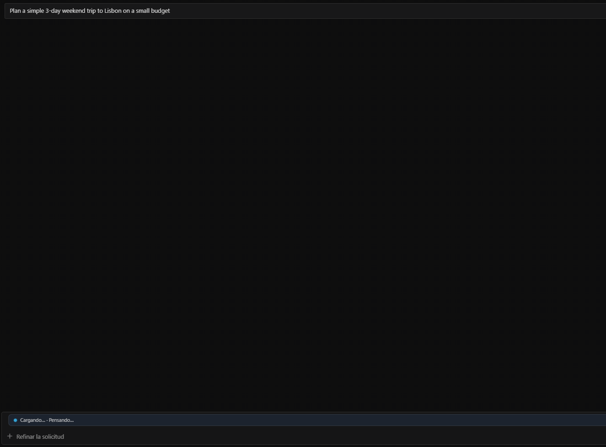 | 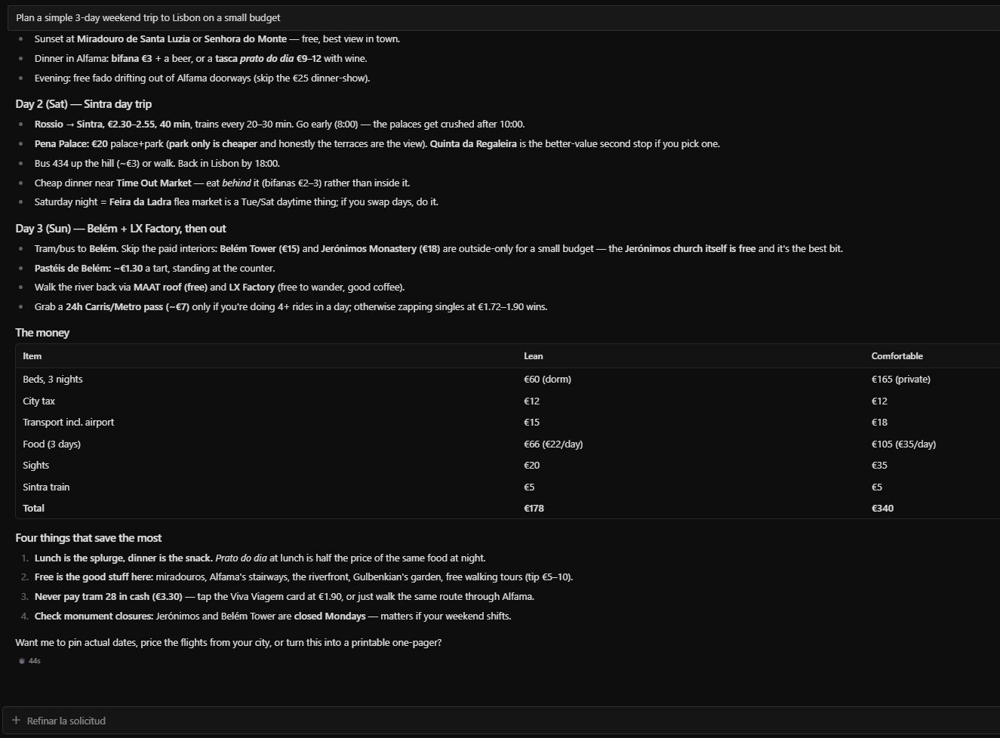 | 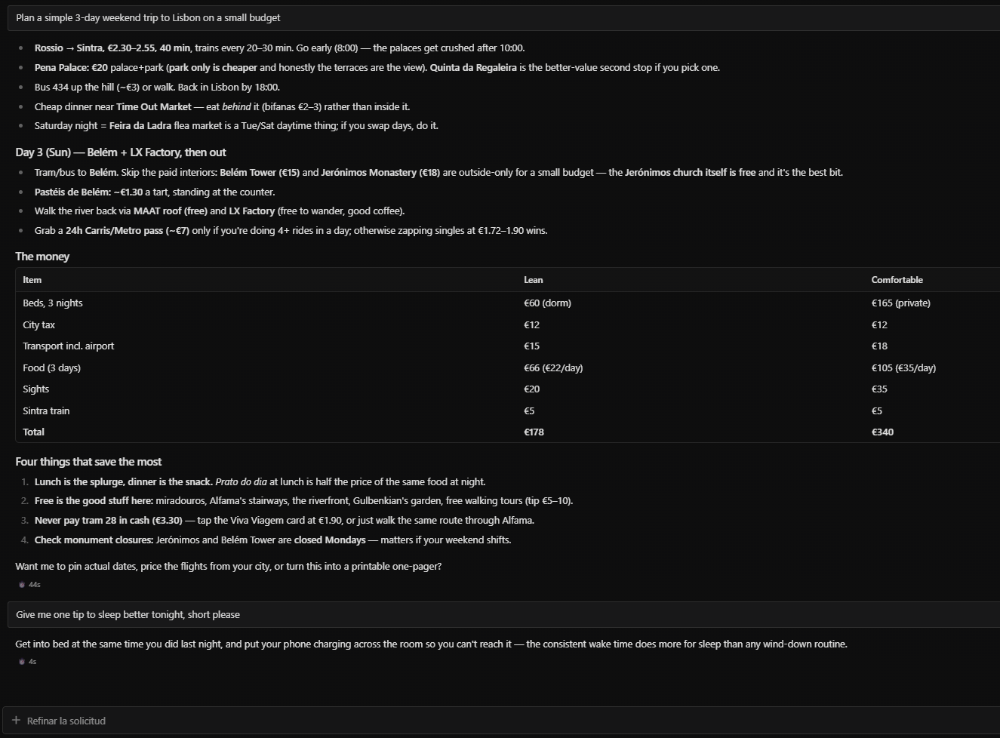 |

*(Real Hermes Desktop captures on a clean demo profile; the UI was in Spanish, so the bar reads "Cargando… · Pensando…".)*

Real Hermes Webapp v0.23.1 (built from source) with this plugin, throw-away profile. **The model there is a simulated local mock** (no API key on that machine), so these frames prove the plugin's wiring, not how a real LLM would phrase things:

| Enable the Desktop half | One-line offer | Created: a normal Bots row |
|---|---|---|
| 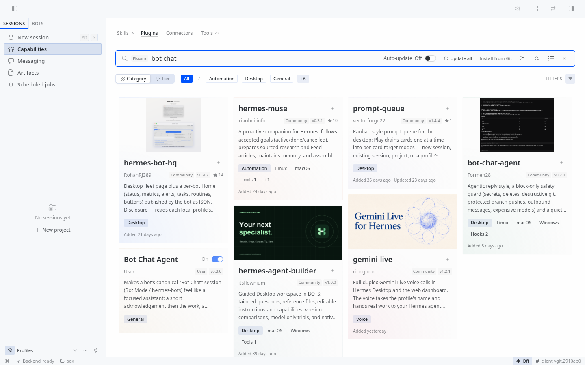 | 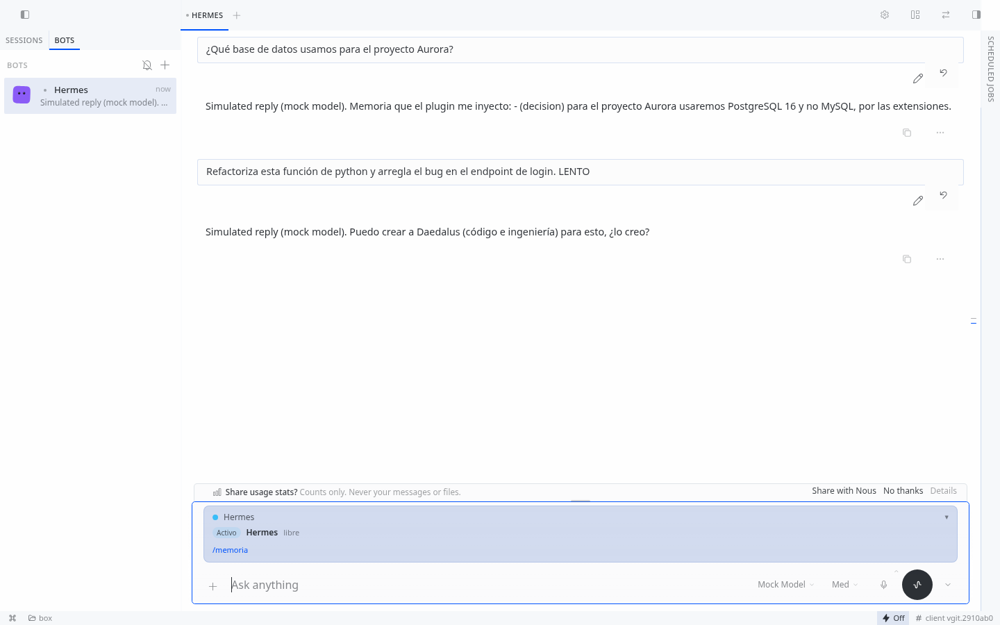 | 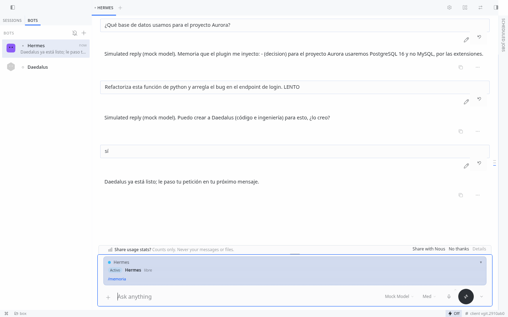 |

| Delegation waiting | Delegation done | Memory in a new session |
|---|---|---|
| 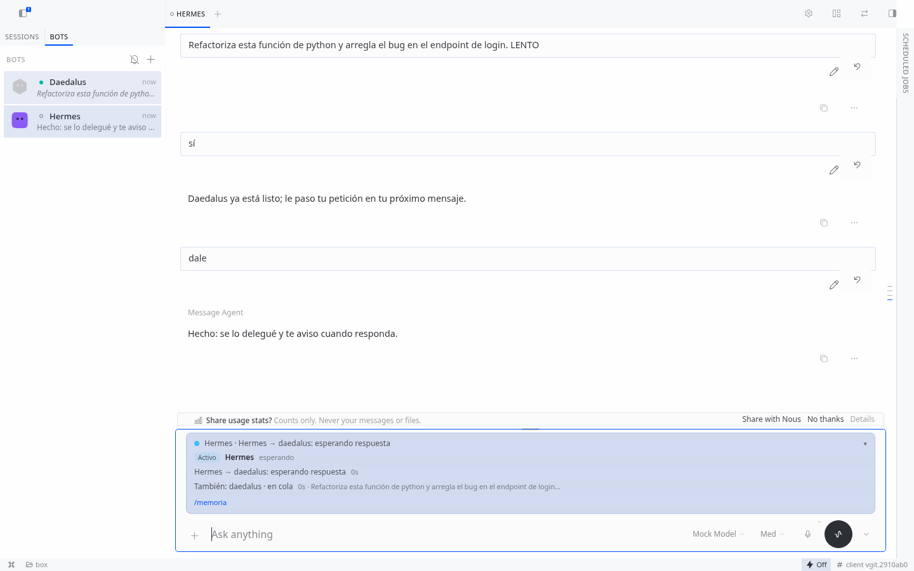 | 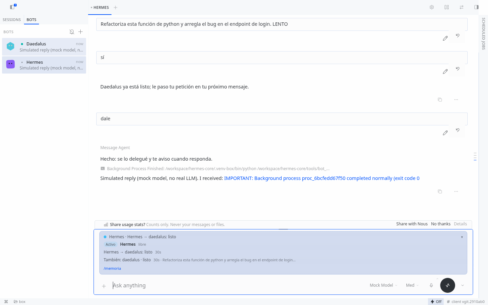 | 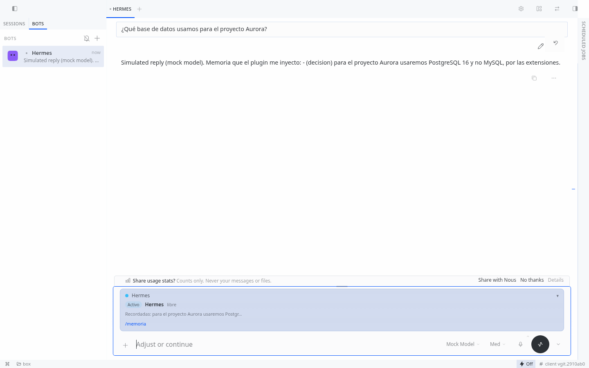 |

Clean-install run (fresh `HERMES_HOME`, real Hermes webapp, simulated model): god row · dark card · memory in a new session.

| | | |
|---|---|---|
| 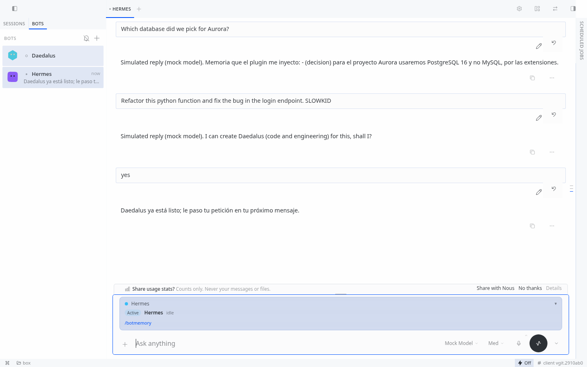 | 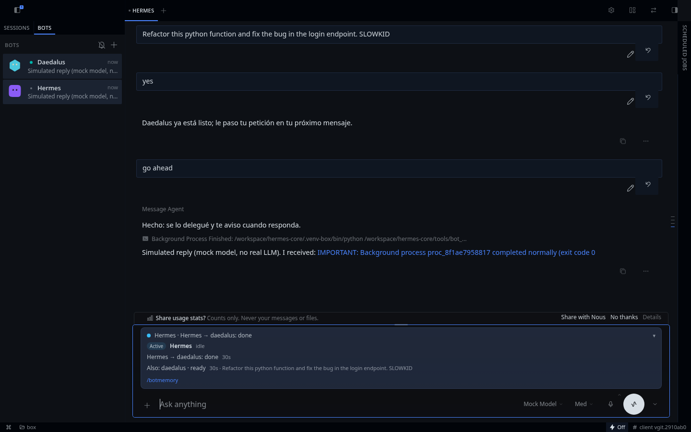 | 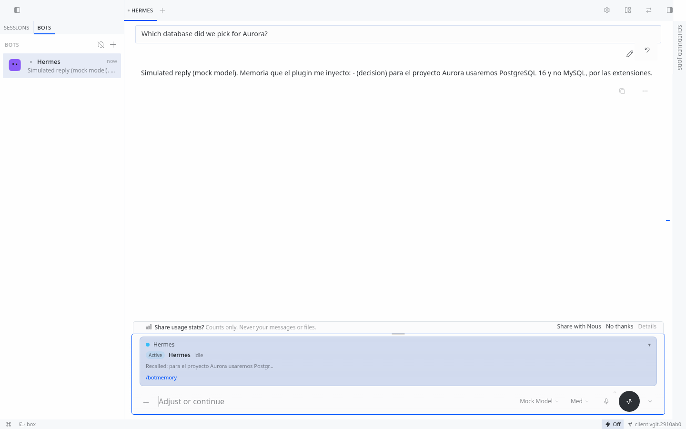 |

## What it does

| Layer | What changes |
|---|---|
| Style (`pre_llm_call`) | A short "act, don't narrate" contract: one acknowledgement (`On it — …`), then the work, then a short result. At most one question per turn. |
| Safety guard (`pre_tool_call`) | **Blocks** risky tool calls (secrets, deletes, destructive git, pushes to protected branches, outbound messages, expensive models, kanban-lock bypasses) and asks you first. Covers both the Bot Chat session and its `delegate_task` / subagent child sessions. It never approves anything. |
| Pending asks | If a mid-turn steer arrives before the first request was answered, the next turn gets a `[Pending asks]` reminder so the first request is not dropped. |
| Memory | Short-term: a rolling summary plus those pending asks. Long-term: decisions, project state and lessons in a local SQLite store, retrieved only when they overlap the current request. No vault, no API keys, no network. |
| Background delivery | With teammates configured, work can run in another process; the origin Bot Chat gets the result (on Hermes 0.23 as a note in the next turn). |
| Panteón (automatic, opt-in) | When a request clearly fits a specialty you have no bot for, Hermes adds ONE line ("I can create Daedalus (code) for this, shall I?"). On a plain yes it creates the profile, adds it to `team.assignees` and hands the request over with `message_agent`. Nothing is created without that yes. See [Panteón](#panteón-automatic-optional-generic). |
| Team | With no `team.assignees`, Bot Chat does the work itself. With profile names configured, it assigns kanban subcards to those profiles and will not close them until the board shows `done`. |
| Desktop | A quiet status bar above the composer (`Working… · <step>`, `Waiting for your OK`, `Waiting on <profile>`, `Done · <summary>`, `Error: <short summary>`), and reasoning collapsed by default while a Bot Chat is focused. Tool and approval cards are untouched. |
| `/memoria` (alias `/botmemory`) | Lists what the plugin remembers (long-term entries by type, short-term summary, pending asks), forgets or edits an entry by id, and clears all after confirmation. Both reply in the language you are writing in (see *Language* below). Registered with the core's `register_command` API; skipped safely if the core does not expose it. |
| Status panel | A compact, expandable card above the Bot Chat composer (same `COMPOSER_AREAS.top` slot as the Working bar). It shows the active bot and other bots, live delegation lines (`Hermes → Daedalus: waiting for reply` → `done`), elapsed time, a stalled warning, pending asks, memories recalled this turn, the compact token count, and a `/memoria` hint. Toggle with `status_panel.enabled`. |

Only sessions titled **"Bot Chat"** (the title Hermes Bot Mode uses) and their compaction children get the reply style.
The safety guard also protects `delegate_task` / subagent child sessions spawned from a Bot Chat (inheriting parent Bot Chat protection), while normal sessions and subagents of normal sessions behave exactly as before.
A kanban worker session is outside that scope, so the assigned profile can deliver its own card. `scope: all` still lets that worker finish the card whose id is `HERMES_KANBAN_TASK`.

## Install

Requires Hermes `>= 0.22.5` (verified: that version already has every hook this plugin uses — `post_llm_call`, `agent_loop_stopped`, `kanban_task_blocked` — checked against the core tags; no raise was needed).

```bash
hermes plugins install Tormen28/hermes-bot-chat-agent     # GitHub shorthand: always the latest version
hermes plugins enable bot-chat-agent
```

- `hermes plugins install bot-chat-agent` installs the **catalog pin**. Until the catalog entry is re-pinned it may still be an older release (check `hermes plugins info bot-chat-agent`: the `Version:` line); use the GitHub form above to get 0.3.0 now.
- Installing from a local checkout: Hermes v0.23 does **not** accept a bare path (`hermes plugins install ./checkout` is read as `owner/repo`). Use a file URL of a git checkout: `hermes plugins install file:///absolute/path/to/checkout`.
- Reinstall over an existing copy: add `--force`.

Desktop / Webapp: **Capabilities → Plugins → Bot Chat Agent** → switch **On** (this enables the Desktop half: card + panteón). Restart the app if it does not appear.
Then open **Bots**, pick a bot and chat.

First things to try (works in any language, the model replies in yours):

- Say `Decision: we use PostgreSQL 16 for project Aurora`, or `Remember that I prefer short answers`; open a new session later and ask about it. `/memoria` or `/botmemory` lists what was kept, in your language. In the Desktop slash menu, pick the command, then press Enter again to send it.
- Ask for something specialised (code, design, research): Hermes offers one line to create the matching bot; answer `yes` / `sí`.
Then open **Bots**, pick a bot and chat.

## Language
The plugin answers in the language **you** write in: Spanish, English, French, Portuguese or German, detected from your latest message (offline, no model call) and remembered for the session, so a short "ok" or "sí" does not flip it. Unknown falls back to English. `language: es` (or `en`, `fr`, `pt`, `de`) forces one language instead.

- Written by the plugin itself, in your language: the status card (labels, "waiting for reply", "stalled", the reason a delegation was stopped), `/memoria`, `/botmemory`, `/pantheon`.
- Written by your model, told which language to use: the panteón offer line, "X is ready", the explanation when a delegation is stopped. A real model follows this almost always; it is an instruction, not a guarantee.
- Specialist presets are recognised in Spanish, English, French, Portuguese and German requests, and a plain yes / no (`oui`, `sim`, `ja`, `non`, `não`, `nein`…) answers an offer.
- Not translated: the role prompts inside the specialists' `SOUL.md` (English / Spanish) and the guard's block messages (English / Spanish).

## When Hermes stops a delegation
Hermes' bot loop guard (`gateway.bot_loop_guard.max_hops`, 4 messages per exchange by default) refuses further `message_agent` calls in one chat, and also refuses a request that was already sent or a bot that needs no answer. The card then shows **stopped** (not *error*) with the reason and what to do, for example *"this chat reached the limit of 4 bot-to-bot messages, so nothing more was sent. Ask me to answer directly, or send a new message to continue."*, and the tool result carries a note telling the coordinator to say the same to you in your language and not to retry. The limit itself is Hermes' (raise `max_hops` if you want longer exchanges).

## Disable / uninstall

```bash
hermes plugins disable bot-chat-agent
hermes plugins remove bot-chat-agent
```
Or switch it off in **Capabilities → Plugins**. Disabling restores your previous "collapse reasoning" setting.

`plugins remove` takes out the Python half only. Two things stay, on purpose or because the core owns them:
your data in `<HERMES_HOME>/bot-chat-agent/` (memories, delivery log; delete the folder to forget everything)
and the Desktop half in `<HERMES_HOME>/desktop-plugins/bot-chat-agent/` (remove it in **Capabilities → Plugins**
or delete that folder). A leftover Desktop half is harmless: it shows no card and probes the missing API once a minute.

## Configuration
In `config.yaml` (all optional; defaults shown):
```yaml
plugins:
  entries:
    bot-chat-agent:
      settings:
        bot_chat_title: "Bot Chat"
        language: auto          # auto = follow the language you write in | en | es | fr | pt | de (forces one)
        style: true
        scope: bot_chat         # bot_chat | all  (where the guard runs)
        preset: default         # strict | default | relaxed
        guard:
          secrets: true
          deletes: true
          destructive_git: true
          protected_push: true
          external_sends: true
          expensive_models: true
          one_question_per_turn: true
        protected_branches: [main, master]
        expensive_model_patterns: ['\bpro\b', 'opus', '\bultra\b', '-max\b']
        external_send_tools: [send_message, react_to_message]
        team:
          assignees: []        # Hermes profile names. Empty = single-operator (the default).
                               # `team.gods` is the old key and still works; if both keys
                               # exist and differ, the plugin refuses to guess and blocks
                               # with an explanation. A fresh install is individual; an
                               # existing install that already lists teammates keeps the
                               # team on (no new key needed). `team.enabled: false` turns
                               # the team off even if names are listed.
        kanban_db: ""          # empty = <HERMES_HOME>/kanban.db (or the HERMES_KANBAN_BOARD path)
        notify_state_path: ""  # empty = <HERMES_HOME>/bot-chat-agent/team-notify.json
        delivery:              # Fase 1a delivery store (SQLite, next to team-notify.json)
          backend: sqlite      # sqlite | json (json = legacy path, revert switch)
          offer_lease_seconds: 600   # an offered notice is re-offered after this
          db_path: ""          # empty = <HERMES_HOME>/bot-chat-agent/deliveries.db
          destination: offer   # Fase 1b: offer (default, in-turn only) | auto | b1
                               # auto/b1 write the result durably into the session
                               # transcript when the core exposes B1 (ctx methods
                               # record_delegation_delivery / record_completion_note);
                               # on the live core (no B1) they fall back to offer.
          relay_limit: 50      # max pending rows per durable-relay attempt
          retention_days: 30   # prune only delivered/seen rows older than this
        context:              # Fase 2: bounded context (rubric docs/fase2-rubric.md)
          dynamic_tokens: 1500   # per-turn budget: project state + notices
          stable_tokens: 300     # budget for the stable style instructions
          per_piece_tokens: 2000 # cap per context piece (plugin policy)
          engine_name: bot-chat  # ContextEngine name; activate with context.engine: bot-chat
          incremental_note: true # after the first turn, only what changed
        memory:                # generic memory; local store only, no vault
          enabled: true
          short_term: true     # rolling summary of earlier turns + pending asks
          long_term: true      # decisions / project state / lessons
          recent_messages: 8
          summary_budget_tokens: 400
          long_term_budget_tokens: 400
          max_entries: 500     # prune oldest when the store grows past this
        panteon:
          auto: true           # one-line offers (never creates without a yes); false = /pantheon only
          first_run_suggestion: true   # one-time starter-set suggestion
          create_wait_seconds: 8
          prefix: ""
          roster_in_context: true
        status_panel:
          enabled: true        # Desktop card + compact [Status] header; false hides both
          stalled_after_seconds: 120  # warn when a running task makes no progress
```
Any `mcp_*` tool whose name contains send/post/reply/publish/tweet/email is also treated as an outbound send.

**Bounded context (Fase 2).** The turn context is split into stable instructions (≤300 tokens), project state, tasks and notices (≤1,500 tokens, 2,000 per piece), measured with the tokenizer. After the first full turn the team note is incremental — only what changed is injected; a turn with no changes injects one short line. Critical constraints are never dropped; anything else that does not fit is listed as dropped. The project card (`<HERMES_HOME>/bot-chat-agent/project-card.md`, wow 7) is the source of truth: manual edits always win, are versioned in the store, and derived content never writes the file. After a cancellation, a compaction or a reopen, the context is rebuilt from the durable store. The plugin also registers a `ContextEngine` named `bot-chat` — **inactive by default**; activate it with `context.engine: bot-chat` in the core config (single slot; without it the `pre_llm_call` hook keeps injecting). It uses only public plugin surfaces: it delegates to the core's own compressor when that is reachable, and otherwise falls back to a small deterministic local compactor (keeps the first/last messages, never splits a tool call from its result, replaces the middle with one digest note; no LLM call). That fallback is weaker than a model-written summary. **Whether any of this makes a very long session faster has NOT been measured** (tests prove the mechanism and bounded sizes, not live latency).

**Memory.** Enabled by default and fully local: a rolling extractive summary of earlier turns (tool payloads skipped) plus the pending-asks reminder, and a long-term store of decisions, project state and lessons at `<HERMES_HOME>/bot-chat-agent/memory.db`. `pre_llm_call` injects only the summary and the entries that overlap the current request, each under its token budget. `post_llm_call` writes new entries back when the turn text contains clear cues (`Decision:` / `Decisión:`, `We decided…`, `Lesson learned:`, `Decidimos`, `Lección:`, plus — only from your own words — `Remember that…`, `From now on…`, `Recuerda que…`, and `Décision :` / `Decisão:` / `Entscheidung:`) — no model and no network. Secret-like text is not stored. Fail-open: a missing store never breaks the turn, and an unreadable one is moved aside (`memory.db.corrupt-<time>`) and recreated. Honest limit on Hermes v0.23: this hook can only *add* a bounded memory block; it cannot replace the core's growing `conversation_history`. The optional `context.engine: bot-chat` path includes the same block in `select_context`. Numbers and method: `docs/memory-bench.md`. Turn the feature off with `memory.enabled: false`.

**`/memoria` and `/botmemory`.** In a Bot Chat session type `/memoria` (Spanish labels) or `/botmemory` (English by default) to see the long-term store, the rolling summary and any pending asks. Each long-term row has an 8-character id: `/botmemory forget ab12cd34` drops one entry, `/botmemory edit ab12cd34 New text` corrects it, `/botmemory clear` asks for confirmation and `/botmemory clear confirm` erases every long-term row. Nothing is changed if the id is unknown or the store cannot be opened.

**Delegations on the card.** `message_agent` is fire-and-forget in the core: it returns a queued ack at once and the teammate's reply comes back later as a background-process completion notice. The plugin shows `Hermes → Daedalus: waiting for reply` from the real ack (`post_tool_call`), and `done` only when a completion notice that names that teammate and carries success evidence (`exit code 0`) arrives; a failure notice shows `error`; ambiguous text leaves it waiting. Works on v0.23.0 and v0.23.1 with no core change.

**Status panel.** The Desktop UI shows an expandable card above the Bot Chat composer (the same `COMPOSER_AREAS.top` slot as the Working / Waiting bar). It lists the active bot and the other bots on the board with their last activity, live delegation lines (`Hermes → Daedalus: waiting for reply`, then `done` when the real completion notice arrives; never `done` by timer or guess), elapsed time on running tasks, a stalled warning when a task makes no progress past `status_panel.stalled_after_seconds` (default 2 minutes), pending asks, memories recalled this turn, the compact token count, and a hint to type `/memoria`. Idle sessions stay quiet. Switch it off with `status_panel.enabled: false`.

Python hooks publish the same state to `<HERMES_HOME>/bot-chat-agent/status.json`. The Desktop half feature-detects `ctx.rest('/status')` (served by `dashboard/plugin_api.py`) and polls it; if that route is not mounted on a given gateway, the card still renders from the last snapshot and never breaks the rest of the plugin. The model-facing `[Status]` header in `pre_llm_call` is unchanged. Real render in Hermes Webapp v0.23.1 (simulated model): `docs/screenshots/11-real-delegation-waiting.png` and `12-real-delegation-done.png`. A headless walkthrough is `demo/hackathon_demo.py`.


### Guard presets

Presets only package the existing YAML rule groups (no free-form regex allowlists; defaults stay safe):

| Preset | Enabled rule groups |
|---|---|
| `strict` | All original 7 rules on, plus `kanban_lock` and `wait_for_god` |
| `default` | Same safe baseline as `strict` |
| `relaxed` | Keeps `secrets`, `destructive_git`, `protected_push`, and `kanban_lock` on; turns off `deletes`, `external_sends`, `expensive_models`, `one_question_per_turn`, and `wait_for_god` |

You can set `preset: relaxed` (or `guard: relaxed`) and still override individual boolean rules inside `guard:`.

## Guard rules
| Rule | Blocks (examples) |
|---|---|
| secrets | reading `.env`, `auth.json`, SSH keys, `*.pem`; `printenv` |
| deletes | `rm`, `Remove-Item`, `del`, `rd /s`, `DROP TABLE`, `DELETE FROM`, `shutil.rmtree` — also through `/bin/rm`, `\rm`, `env rm`, `bash -c "…"`, `powershell -Command`, `eval`, `$(…)`, inline base64 and `-EncodedCommand` |
| destructive_git | `push --force`, `reset --hard`, `clean -f`, `branch -D`, `rebase` |
| protected_push | `git push … main`, merges into protected branches, `gh pr merge` |
| external_sends | `send_message`, `react_to_message`, outbound MCP tools; a local file leaving through the network (`curl -d @file`, `-F f=@file`, `--post-file`, `… \| nc host`, `scp file user@host:`). Loopback targets are allowed |
| expensive_models | `delegate_task` with a model matching the patterns |
| one_question_per_turn | a second `clarify` in the same turn |
| kanban_lock | writing `kanban.db`, mutating `hermes kanban` from the shell, impersonating the user, or creating a card that is already finished. Missing `idempotency_key` on `kanban_create` is filled in, not blocked |
| obfuscated_exec | decoded or decompressed data piped into a shell/interpreter (`… \| base64 -d \| bash`, `bash <(base64 -d …)`, `eval "$(… \| base64 -d)"`) |
| memory_injection | instruction-like text ("always approve…", override phrases) written into `MEMORY.md`, `USER.md`, `SOUL.md`, `AGENTS.md`, memory tools or `>> MEMORY.md` |
| wait_for_god | `kanban_complete` (and review/archive) of a card assigned to `team.assignees`, or of an ancestor that still has such a card open, until that card's status is `done` |

The guard is a safety net based on patterns, not a sandbox. Keep Hermes's own approval settings on.

**What 0.3.0 hardening covers (and what it does not).** Every command is analysed in several forms: as written, normalised (absolute binary paths, alias backslashes, quote splicing, `sudo`/`env`/`nohup` wrappers) and every nested payload it can recover (`sh -c`, `eval`, `$(…)`, inline base64, PowerShell `-EncodedCommand`). The same rules run on each form. Still NOT covered: payloads built at run time (hex-escaped strings, variables concatenated across lines, scripts written to disk then run), and piping a remote download into a shell. Treat it as a seatbelt.

**Untrusted content (A0.7).** Tool output that contains instruction-like text (instruction-override phrases, "approve everything", role markers…) is wrapped as labelled untrusted data by the `transform_tool_result` hook (core 0.23+; on older cores a one-line notice is added to the next turn instead). Worker summaries that Bot Chat itself puts in the context are neutralised (instruction-like spans removed, length capped). Turn it off with `untrusted.wrap_tool_results: false`. This lowers the risk; it cannot make injection impossible.

## One bot or a team

Both work. Nothing here depends on a particular set of profile names.

**Single-operator** (no `team.assignees`, the default on a fresh install). You ask, Bot Chat says `On it — …` and does the work in that chat. It does not create teammates, and it does not wait on a board. A `kanban_create` naming any profile is blocked: individual mode invents no teammates (an unassigned card is still allowed — that is your own board work, not delegation). The kanban lock still applies if the model tries to write the board database directly.

**Team.** Put existing Hermes profile names in `team.assignees` (the names you already use, whatever they are; `team.gods` is the old key and still works). When work belongs to one of them, Bot Chat creates a kanban subcard assigned to that profile. The guard then refuses to close that card, or a parent/fork that still has it open, until `kanban.db` shows the card `done`. The assigned profile delivers with `kanban_complete` inside its own dispatcher worker. The next Bot Chat turn gets a one-line result note, once, and the Desktop bar can show `Waiting on <profile>` and then `Done · <summary>`. A blocked card (`kanban_task_blocked`) is announced the same way. Deliveries are stored in SQLite (`deliveries.db`, protocol `pending → offered → delivered_in_turn`): a notice is offered to a turn, and only confirmed after that turn generates — an interrupted turn loses nothing, the notice is re-offered next turn or when its 10-minute lease expires. Each notice goes only to the session that created the card (tracked via `kanban_create`); without a known session it waits in an unassigned tray and is never announced in another chat. Delivery failures are logged at `warning`, never swallowed.

A new default never disables an existing team: if your config already lists teammates (under `team.assignees` or the old `team.gods`) and has no `team.enabled` key, the team stays on. `team.enabled: false` turns the team off explicitly, even with names listed.

### Core version and degradation

Minimum core is `>= 0.22.5` (that version already has all three hooks this plugin depends on). On an older core the plugin still loads — the core warns on unknown hook names but stores them — and degrades as follows, with nothing silently lost:

| Missing hook | What degrades | What still holds |
|---|---|---|
| `post_llm_call` | Offers are never confirmed by a generated turn; notices are re-offered next turn or when the 10-minute lease expires (at-least-once, deduplicated by ID in the text) | No notice is lost; the lease is the mechanism |
| `agent_loop_stopped` | No fast release on `/stop`; offers are released only by lease expiry | Same as above — slower, not lost |
| `kanban_task_blocked` | A blocked card is never announced in chat (no notice is invented); the card stays visible on the board | The user sees it on the board; nothing is announced in the wrong session |

A contradictory team config (`team.assignees` and `team.gods` both set and different) fails closed: every tool call in scope is blocked with the explanation, the error is logged at load, and the turn note shows it — the guard and the team are never silently disabled.

`wait_for_god` is off in the `relaxed` preset. `team.enabled: false` also turns the team note and the wait off, even if names are listed.

### How the wait is enforced

It is a `pre_tool_call` decision, not only prompt text. On `kanban_complete`, `kanban_request_review`, and `kanban_archive` the plugin opens the board **read-only**, reads `tasks` and `task_links`, and blocks while a configured assignee (or a descendant assigned to one) is not `done`. There is one hook, shared with the 0.2.0 rules, so a second plugin is not required and cannot disagree.

The worker is allowed to finish only its own card: Hermes sets `HERMES_KANBAN_TASK` to that id, and a kanban-sourced worker session is outside Bot Chat scope. Shell `hermes kanban complete`, SQL against `kanban.db`, a `created_by: user` spoof, and a `kanban_create` that is already `done` or already has a `result` are blocked as the kanban lock.

### What this plugin does not include

Hermes already owns the board. This plugin does not ship `kanban_*` tools, does not start the dispatcher, and does not edit profiles. The only profiles it ever creates are panteón specialists, only after your yes (or `/pantheon create … confirm`), and only through the Desktop half calling the app's own `profiles.create`.

- The orchestrator profile needs the Hermes `kanban` toolset, or `kanban_create` is not there to call.
- A running gateway dispatcher spawns the assignee. Profile names in `team.assignees` must already exist (panteón creates them for you after a yes); this plugin will not invent them behind your back.
- Hermes stamps `tasks.session_id` from `HERMES_SESSION_ID`. That is how the turn note lists open cards for this chat. Completing by task id still checks the assignee even when `session_id` is missing.
- Hermes `kanban.auto_subscribe_on_create` (default true) wakes the originating chat when a card finishes. This plugin adds the one-line note and the Desktop phases; it does not replace that subscription.
- Default board path: `<HERMES_HOME>/kanban.db`, or `<HERMES_HOME>/kanban/boards/<HERMES_KANBAN_BOARD>/kanban.db`. Override with `kanban_db` or `HERMES_KANBAN_DB`.
- Delivery store: `<HERMES_HOME>/bot-chat-agent/deliveries.db` (SQLite; task id, kind, session id, assignee, one-line summary, status). Override with `delivery.db_path`. The legacy `team-notify.json` is imported once (pending entries not yet announced) and never modified afterwards; `delivery.backend: json` reverts to the legacy path without uninstalling. The store must live on a local disk, never in a synced folder or on a network path (checked at startup, warning only). Fase 1b: the outbox is complete — relay claim leases, dead-letter after 5 failed attempts, retention prune (delivered/seen only, `delivery.retention_days`), `oldest_pending_age_seconds` in `stats()`, and a switchable durable destination: `delivery.destination: offer` (default — the result is offered in the next turn) or `auto`/`b1`, which writes the result as a durable row in the destination session's transcript when the core exposes B1, with a stable id per delivery (a retry after a crash returns the same message id, never a second row) and a durable mark recorded before confirming, so a crash between the write and the confirm can never re-offer the result.
- It does not write `state.db` or `kanban.db`, and it does not edit `SOUL.md` or profile files.

## Panteón (automatic, optional, generic)

The panteón is a small team of specialist bots. They are ordinary Hermes profiles, so they appear as **rows in the stock Bots panel** next to your bot. There is no separate panel.

**It is almost automatic, but never without your yes.** With the Desktop half on, when a Bot Chat request clearly fits one specialty you have no bot for, Hermes answers as usual and adds one short line, for example *"I can create Daedalus (code and engineering) for this, shall I?"* (in your language). Answer **yes** and the plugin creates the profile, adds it to `team.assignees` and Hermes hands the request over with `message_agent`; the row shows up in **Bots** and the status card follows the delegation. Answer **no** and it will not ask for that specialty again for three days. Once, on a fresh install, Hermes may also suggest a small starter set (Daedalus, Iris, Athena); it creates nothing until you say yes.

Presets (neutral names, no personal data): `daedalus` code · `iris` design · `athena` research · `calliope` writing · `dionysus` games · `nike` QA/review · `mnemosyne` docs.

Good to know:

- The offer line is an instruction injected into Bot Chat turns; **a real model follows it most of the time but not guaranteed** (the screenshots use a simulated model that always follows it).
- A new bot appears in Hermes' tool list from the *next* turn, so on the very first creation Hermes may say "Daedalus is ready, I'll pass it on with your next message"; the plugin then reminds it (at most twice) and the hand-off happens on your next message.
- Without the Desktop half enabled (or if profile creation fails) nothing is created and Hermes is told to print the exact `hermes profile create` lines instead.
- Turn the whole thing off with `panteon.auto: false` (keep `/pantheon`), and the first-run suggestion with `panteon.first_run_suggestion: false`.

`/pantheon` (alias `/panteon`) remains as an advanced fallback:

```
/pantheon                          # list presets, which profiles exist, who is in the team
/pantheon show iris                # the role prompt
/pantheon plan daedalus iris       # dry run + the equivalent `hermes profile create` lines
/pantheon create daedalus iris confirm   # creates the profiles via the Desktop half (needs it On)
/pantheon team daedalus iris confirm     # writes team.assignees
/pantheon team off confirm               # back to single-operator
```

Nothing is created or changed without the word `confirm`. Existing profiles are never touched. Use your own profiles instead of presets by listing their names in `team.assignees`. `panteon.prefix` prepends a prefix to preset profile names; `panteon.roster_in_context: false` drops the roster line.

## Honest limits

- **Long-session speed is not measured.** The memory block is bounded and tested (~720 tokens in a synthetic 200-turn bench), but on Hermes v0.23 the core's own history still grows, the optional context engine is off by default, and nobody has timed a real long session with it on. Tests passing is not the same as "a long session is no longer slow".
- Memory extraction is cue-based (no model). The panteón offer depends on the model following an injected instruction.
- Screenshots 05–12 use a simulated model; they show the wiring, not real LLM quality.
- Durable in-transcript delivery needs core APIs that v0.23 does not expose; on 0.23 the result is offered in the next turn (nothing is lost).

## Disclosures
- Reads `<HERMES_HOME>/state.db` **read-only** (sessions table: id, title, parent, source) to find Bot Chat sessions. Never writes it.
- Reads the kanban board **read-only** (`tasks`, `task_links`) when team wait or the open-card note needs it. Never writes it.
- Never reads `.env`, `auth.json` or any credential store. No network calls. No telemetry.
- Writes only under `<HERMES_HOME>/bot-chat-agent/` (`memory.db`, `deliveries.db`, `status.json`, `panteon-auto.json`, `dm-delegations.json`, optional `project-card.md`). Cron-bridge writes (pause/resume/remove a job) go through the core's own `cronjob_manage` tool via the public tool registry, never by editing `jobs.json`.
- Desktop half: after your yes it calls the app's stock `profiles.create` / `profiles.configure` for one preset profile and reports the result to `/api/plugins/bot-chat-agent`. It never creates a profile without that yes.
- Desktop: changes the `reasoning.collapsedByDefault` setting while a Bot Chat is focused and restores the previous value when you leave it or disable the plugin. If the app crashes inside a Bot Chat, the setting may stay on; toggle it in Settings.

## Known limitation
The public Desktop SDK can collapse reasoning but cannot hide tool cards per session. Full "answer-only" display
needs a new Desktop SDK hook (proposed upstream). Until then tool cards still show in Bot Chat.

## Development
```bash
python -m pytest tests -q
hermes plugins validate . --install-deps
```

Strict stability run (exit code AND `ok is True`, battery compared by test name, `hermes send` checked, one final notification):

```bash
python tools/stability/runner.py --plugin <installed plugin dir> --python <python with pytest> \
    --live-python <hermes venv python> --minutes 60 --notify-final
python tools/stability/r26_audit.py <plugin dir>     # disclosure audit: static + runtime (audit hook)
```

POSIX-only tests (`fork`, `SIGKILL`) are skipped on Windows with a reason; `tests/test_concurrency_spawn.py` covers the same store guarantees there with real `spawn` contention.

## License
MIT. See [LICENSE](LICENSE).

---

## Español

> Un Bot Chat de Hermes más tranquilo y simple, para quien solo quiere respuestas, con memoria, una tarjeta de estado y un equipo de especialistas que solo aparecen si tú dices que sí.

**0.3.0** suma, sobre la 0.2.0 (estilo, guardia, barra de estado): guardia reforzada, recordatorio de pedidos pendientes, memoria local corta y larga (`/memoria`), entrega durable en segundo plano, tarjeta de estado con delegaciones entre bots, un **panteón casi automático pero opcional** de bots especialistas dentro del panel **Bots** de siempre, un puente a cron y un motor de contexto opcional (apagado por defecto).

**Dos mitades, un paquete.** La mitad Python funciona al activar el plugin. La mitad **Desktop** (tarjeta de estado, ofertas del panteón y creación de perfiles) es **opcional dentro de la app**: abre **Capacidades → Plugins → Bot Chat Agent** y ponla en **On**. Sin eso sigues teniendo estilo, guardia y memoria, pero no la tarjeta ni las ofertas, y `/pantheon create` solo te imprime los comandos de terminal.

### Por qué existe

Hermes es muy potente, y esa potencia se ve en pantalla: bloques de razonamiento, tarjetas de herramientas,
diffs, logs, preguntas de seguimiento. Para un desarrollador eso está genial. Para mucha gente (estudiantes,
emprendedores, familia, cualquiera que no sea técnico) puede ser abrumador.

**Bot Chat Agent** les da un Bot Chat de Hermes más amable: preguntas, ves una barra discreta de
*"Cargando…"* y recibes una respuesta corta y directa. Menos cosas en pantalla, menos preguntas, el mismo
Hermes por debajo. Si quieres ver todo el detalle, abre una sesión normal: queda exactamente igual.

### Capturas

| Cargando | Respuesta | Corto y directo |
|---|---|---|
|  |  |  |

### Qué hace

| Capa | Qué cambia |
|---|---|
| Estilo (`pre_llm_call`) | Un contrato corto de "actúa, no narres": un acuse (`Voy a…`), hace el trabajo, resultado corto. Máximo una pregunta por turno. |
| Guardia de seguridad (`pre_tool_call`) | **Bloquea** acciones riesgosas (secretos, borrados, git destructivo, push a ramas protegidas, mensajes salientes, modelos caros, saltarse el candado del kanban) y te pregunta primero. Cubre tanto el Bot Chat como sus subagentes hijos (`delegate_task`). Nunca aprueba nada por ti. |
| Equipo | Sin `team.assignees`, el Bot Chat hace el trabajo él solo. Con nombres de perfiles, asigna subtareas y no las cierra hasta que el tablero las muestra hechas. |
| Desktop | Una barra de estado discreta (`Cargando… · <paso>`, `Esperando tu OK`, `Esperando a <perfil>`, `Listo · <resumen>`, `Error: <resumen corto>`) y el razonamiento colapsado por defecto mientras estás en un Bot Chat. Las tarjetas de herramientas y de aprobación no se ocultan ni se tocan. |

Solo las sesiones llamadas **"Bot Chat"** (el título que usa el Modo Bot de Hermes) y sus hijas de compactación reciben el estilo de respuesta.
La guardia de seguridad también protege las sesiones hijas `delegate_task` / subagentes lanzadas desde un Bot Chat (heredan la protección del Bot Chat padre), mientras que las sesiones normales, los subagentes de sesiones normales y kanban siguen igual.
Puedes elegir un preset de guardia (`preset: strict | default | relaxed`). `strict` y `default` incluyen el candado del kanban y la espera al compañero. `relaxed` deja el candado puesto y apaga la espera. Sin nombres en `team.assignees` no hay equipo: el bot trabaja solo y no inventa perfiles. El detalle está en inglés, arriba.

### Instalar

Requiere Hermes `>= 0.22.5`.

```bash
hermes plugins install Tormen28/hermes-bot-chat-agent
hermes plugins enable bot-chat-agent
```
`hermes plugins install bot-chat-agent` instala la versión **fijada en el catálogo**, que puede ser una anterior hasta que se re-fije (mira la línea `Version:` en `hermes plugins info bot-chat-agent`). Desde una carpeta local, Hermes v0.23 no acepta una ruta suelta: usa `hermes plugins install file:///ruta/absoluta/al/checkout`. Para reinstalar encima: `--force`.

Desktop: **Capacidades → Plugins → Bot Chat Agent** → activar (es la mitad Desktop: tarjeta y panteón). Reinicia la app si no aparece.
Luego abre **Bots**, elige un bot y chatea.

Para probar: escribe `Decisión: usamos PostgreSQL 16 para Aurora` o `Recuerda que prefiero respuestas cortas`, abre una sesión nueva más tarde y pregunta por eso; `/memoria` te muestra lo guardado (en el menú de comandos, elige el comando y pulsa Enter otra vez para enviarlo). Pide algo especializado (código, diseño, investigación) y Hermes te ofrecerá en una línea crear el bot adecuado: responde `sí`.

### Desactivar / desinstalar

```bash
hermes plugins disable bot-chat-agent
hermes plugins remove bot-chat-agent
```
O apágalo en **Capacidades → Plugins**. Al desactivarlo se restaura tu ajuste anterior de "colapsar razonamiento".

### Configuración y privacidad

La configuración (`language: es` para respuestas en español), las reglas de la guardia y las divulgaciones
están detalladas arriba en inglés. En resumen: lee `state.db` **solo en modo lectura** para encontrar los Bot Chat,
nunca lee `.env`, `auth.json` ni credenciales, no hace llamadas de red y no envía telemetría. El contexto acotado
(Fase 2) se activa con `context.engine: bot-chat`; la ficha de proyecto vive en
`<HERMES_HOME>/bot-chat-agent/project-card.md` y puedes editarla a mano: tus ediciones siempre mandan.

**Panteón.** Con la mitad Desktop encendida, cuando un pedido encaja claramente con una especialidad sin bot, Hermes responde normal y añade una línea corta (p. ej. *«Puedo crear a Daedalus (código e ingeniería) para esto, ¿lo creo?»*). Si dices **sí**, se crea el perfil, entra al equipo y Hermes le pasa el pedido; si dices **no**, no vuelve a ofrecerlo en tres días. Una sola vez, en una instalación nueva, puede sugerir un equipo inicial pequeño (Daedalus, Iris, Athena) y no crea nada hasta que digas que sí. `/pantheon` sigue como respaldo avanzado (`/pantheon plan …`, `/pantheon create … confirm`, `/pantheon team … confirm`). Se apaga con `panteon.auto: false`. La línea de oferta es una instrucción al modelo: **un modelo real la sigue casi siempre, no siempre**. Un bot recién creado aparece en las herramientas desde el turno siguiente, así que la primera vez Hermes puede decirte «ya está listo, te lo paso con tu próximo mensaje».

**Límites honestos.** **No se ha medido la velocidad en sesiones largas**: el bloque de memoria está acotado y probado, pero el historial del core sigue creciendo y el motor de contexto opcional (`context.engine: bot-chat`) viene apagado; que las pruebas pasen no significa que una sesión larga ya no sea lenta. La extracción de memoria es por frases clave (`Decisión:`, `Decidimos…`, `Lección:`), sin modelo. Las capturas 05–12 usan un **modelo simulado**: muestran el cableado del plugin, no la calidad de un LLM real. Las capturas 01–03 son de Hermes Desktop real.

**Memoria entre sesiones.** Verificado en vivo: una decisión guardada en una sesión de Bot Chat vuelve en una sesión nueva distinta (capturas 07 y 08).

**Limitación conocida:** el SDK público de Desktop puede colapsar el razonamiento pero aún no puede ocultar las
tarjetas de herramientas por sesión, así que esas tarjetas siguen visibles en Bot Chat.

### Licencia
MIT. Ver [LICENSE](LICENSE).
